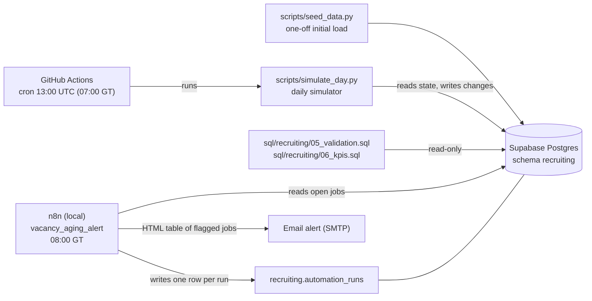

# Recruiting & Vacancy Performance

A recruiting reporting model on **synthetic data** that changes every day: a Python
simulator advances hiring activity in a Supabase Postgres database, SQL files
validate the data and compute the KPIs, and an n8n workflow sends a daily email
alert for aging and stale vacancies.

Project page: [`projects/recruiting-analytics.html`](../../projects/recruiting-analytics.html)

## Architecture

Daily order: the simulator closes the previous day at 07:00 Guatemala time, and n8n
checks the open vacancies at 08:00 and emails the ones that are 45+ days open or
14+ days without an update.

## Files

| Path | What it does |
|---|---|
| `sql/recruiting/04_simulation_tables.sql` | Migration: `requisition_queue`, `application_events`, `simulation_runs` (`CREATE TABLE IF NOT EXISTS`, no drops) |
| `sql/recruiting/05_validation.sql` | Row counts and 26 pass/fail checks (orphans, date order, hire consistency, numerators vs denominators, simulator gaps) |
| `sql/recruiting/06_kpis.sql` | KPI queries with their definitions in comments |
| `scripts/recruiting_sim.py` | Shared engine and the single `CONFIG` block with every parameter |
| `scripts/seed_data.py` | 180 days of reproducible history, loaded in one transaction |
| `scripts/simulate_day.py` | Idempotent daily simulator with catch-up and `--dry-run` |
| `scripts/run_sql.py` | Runs a SQL file and prints each result set |
| `scripts/simulate_day.bat` | Windows Task Scheduler fallback |
| `.github/workflows/simulate_day.yml` | Daily schedule plus manual run |
| `workflows/vacancy_aging_alert.json` | n8n workflow export (no credentials) |

## Documentation

- [Data model](data_model.md): tables, grain, keys, relationships.
- [Synthetic data](synthetic_data.md): generation and simulation parameters and assumptions.
- [Runbook](runbook.md): how to run, schedule, test and recover each part.

## Limitations

- **All data is synthetic.** Volumes, conversion rates and time-to-fill come from
  parameters chosen to look plausible, not from a real company. They show that the
  pipeline and the definitions work; they are not hiring benchmarks.
- **n8n runs locally**, so the alert only runs while that PC is on and n8n is running.
  If the PC is off at 08:00 that day has no alert and no `automation_runs` row. The
  simulator does not depend on it: it runs on GitHub Actions and catches up missed days.
- GitHub disables scheduled workflows in repositories with no commits for 60 days;
  re-enable it from the Actions tab (missed days are caught up, 30 per run).
- The schema has no `withdrawn_at` column. A withdrawal is recorded by
  `current_stage = 'withdrawn'`, `last_updated_at` and its row in `application_events`.
- Status history of jobs (open ↔ on_hold) is not stored, so "open vacancies" is the
  current status, not a point-in-time count for past dates.
