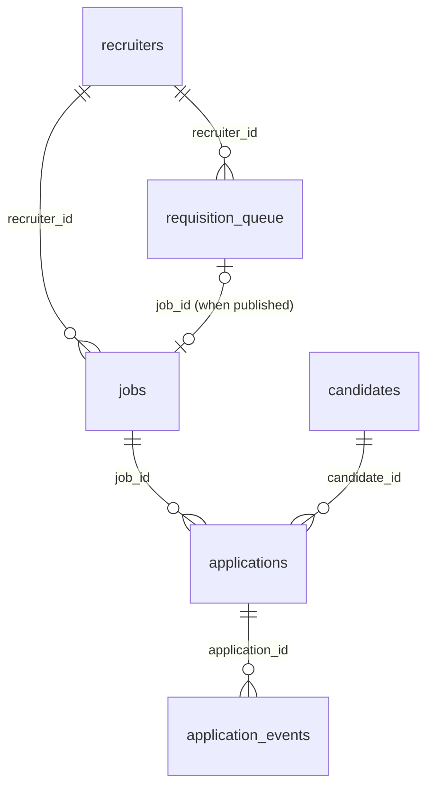

# Recruiting data model

PostgreSQL (Supabase), schema `recruiting`. Synthetic records only: no names, emails,
phone numbers or any other personal attribute. The base tables come from
`01_create_tables.sql` (kept outside the repo; it starts with `DROP SCHEMA`, so it is
never re-run). The simulator tables come from
[`sql/recruiting/04_simulation_tables.sql`](../../sql/recruiting/04_simulation_tables.sql).
Timestamps are `timestamptz`; days are counted in Guatemala time (UTC-6).

## Relationships

`simulation_runs` and `automation_runs` are logs with no foreign keys.

## Tables

| Table | Grain | Key | Main columns |
|---|---|---|---|
| `recruiters` | one recruiter | `recruiter_id` (R01…) | `team` (Tech, Commercial, Corporate), `is_active`, `created_at` |
| `requisition_queue` | one approved requisition | `requisition_id` (REQ0001…) | `title`, `department`, `recruiter_id`, `requested_at`, `scheduled_open_date`, `status`, `job_id` |
| `jobs` | one vacancy | `job_id` (J0001…) | `title`, `department`, `recruiter_id`, `status`, `created_at`, `last_updated_at`, `closed_at` |
| `candidates` | one synthetic candidate | `candidate_id` (C00001…) | `region`, `created_at` only |
| `applications` | one candidate applying to one job | `application_id` (A000001…); unique (`candidate_id`, `job_id`) | `source`, `current_stage`, `applied_at`, `screened_at`, `interviewed_at`, `offer_at`, `hired_at`, `rejected_at`, `last_updated_at` |
| `application_events` | one stage transition | `event_id` (bigserial) | `application_id`, `from_stage`, `to_stage`, `event_at`, `sim_date` |
| `simulation_runs` | one simulated day | `run_id`; unique `sim_date` | `jobs_published`, `jobs_closed`, `jobs_on_hold`, `applications_created`, `stage_changes`, `hires`, `rejections`, `withdrawals`, `status`, `error_message` |
| `automation_runs` | one n8n run | `run_id` | `run_at`, `workflow_name`, `threshold_days`, `jobs_checked`, `jobs_flagged`, `flagged_job_ids`, `alert_sent`, `status`, `error_message` |

## Rules enforced by the database

- `jobs.status` ∈ open, on_hold, filled, cancelled. `closed_at` is NULL for
  open/on_hold and required for filled/cancelled; `closed_at ≥ created_at`;
  `last_updated_at ≥ created_at`.
- `applications.current_stage` ∈ applied, screening, interview, offer, hired,
  rejected, withdrawn. `source` ∈ linkedin, referral, job_board, career_site, agency.
- Stage dates are ordered (`screened_at ≥ applied_at`, `interviewed_at ≥ screened_at`,
  `offer_at ≥ interviewed_at`, `hired_at ≥ offer_at`, `rejected_at ≥ applied_at`); an
  offer requires an interview and a hire requires an offer; an application cannot be
  both hired and rejected; `hired` / `rejected` require their date.
- `requisition_queue.status` ∈ queued, published, cancelled; `job_id` is set exactly
  when the status is published; `scheduled_open_date ≥ requested_at`.
- `application_events`: `from_stage` is NULL only for the first event (`to_stage = 'applied'`).
  `sim_date` is NULL for events written by the seed.
- `simulation_runs.status` ∈ success, error, seed; one row per `sim_date`. The `seed`
  row marks the last day covered by the seed.

## Rules kept by the generator and checked by `05_validation.sql`

- One hire per job; a filled job has exactly one hire and `closed_at ≥ hired_at`.
- When a job closes (filled or cancelled) every remaining active application is rejected.
- No application before its job opened or after it closed; candidates exist before
  their first application.
- `applications.current_stage` and `last_updated_at` match the latest event.
- `jobs.last_updated_at` is the latest activity on the job (status change, new
  application or stage change), which is what the n8n stale check reads.

## Known gaps

- No `withdrawn_at`: use `application_events` (`to_stage = 'withdrawn'`) for the date.
- No status history for jobs: on_hold periods are not stored.
